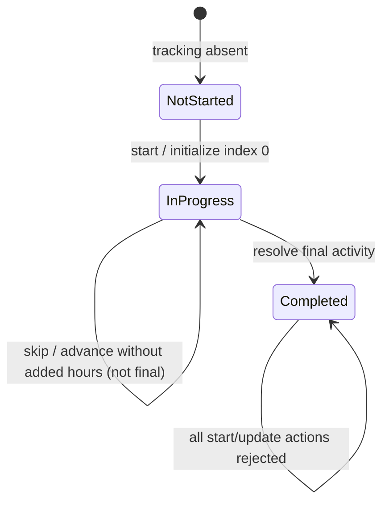

# Firebase Trip Tracking Architecture

## Context

This design implements approved requirement `FEAT-001` for the actual target, `Frontend/TripNova-angular-app`: an Angular standalone application using the Firebase Web SDK and Realtime Database. Repository-level `CLAUDE.md` stack notes describe a different application and are stale for this feature; they are not used as implementation guidance.

The traveler supplies a trip ID. The app loads the matching record from `/userTrips/{tripId}`, displays its plan and itinerary, and persists one-time progress and outcomes on that same record. A missing ID must not be replaced with a sample/default ID, and a missing record must not fall back to mock data.

## Current State

- `TravelMockComponent` currently owns a hardcoded sample trip and in-memory progress, defaults an empty ID to `1`, and offers a restart action. Those behaviors must be replaced for this flow.
- `RealtimeDatabaseService` initializes/reuses the Firebase app from the existing `firebase.config.ts`, and currently reads/writes only demo-user records. It does not yet expose trip lookup or tracking operations.
- The trip screen already computes checkpoints from `days[].activities[]` and has UI behaviors for start, on-time, delay, missed, recovery, drop, skip, and completion. Its local delay is in minutes; the approved requirement specifies hours in storage and input.
- The app is standalone Angular and uses Vitest through Angular CLI. Firebase SDK dependency is already present; no new backend or persistence system is needed.
- Existing tracked trip record shape and deployed Realtime Database rules were not available for inspection. Requirements confirm the path and the top-level itinerary fields but identify the exact stored shape and permissions as dependencies.

## Proposed Solution

Keep the change within the existing trip screen and `RealtimeDatabaseService`, reusing the existing Firebase app/configuration. Do not introduce a repository layer, backend endpoint, new database, or trip-record rewrite.

1. Trim and validate the supplied ID. An empty value remains an input/prompt state; never substitute `1` or a mock record.
2. Read exactly `/userTrips/{tripId}` using Realtime Database `get`. If absent, clear any previously displayed trip and show not found. If present, use the record as the source of truth for both trip fields and tracking state.
3. Derive the ordered checkpoint list by flattening `days` in stored order and each day's `activities` in stored order. Keep the original day/activity objects and all other record fields intact; derive presentation checkpoints rather than rewriting the itinerary.
4. Treat an absent `tracking` object as an unstarted trip. Loading must not create tracking state. A start action initializes tracking once through the same transaction mechanism as subsequent actions.
5. Apply every start or tracking event with a Firebase `runTransaction` on `/userTrips/{tripId}`. The transaction callback verifies that the root record still exists, reads current tracking, checks whether the requested transition is legal, and returns a shallow copy of the latest root record with only its `tracking` child replaced. Returning `undefined` aborts an invalid or duplicate transition. Never reconstruct the root from a client-side copy.
6. Make the transaction callback deterministic and side-effect free because Firebase may invoke it repeatedly. Generate a command/event ID once per user action, outside the callback, and persist it in `lastEvent`; if a retry sees the same ID as the last committed event, abort as a duplicate. Each progress command also carries the status and checkpoint index displayed when the user invoked it. The transaction verifies these expected values against its current snapshot; if another action committed first, the stale command aborts instead of applying to a later checkpoint. Transaction retries serialize competing changes against the latest committed tracking state.
7. Update the screen from the committed transaction result, not from optimistic local mutations. On transaction abort, refresh current state and explain that the action is no longer available. On transport/rules failure, retain the last loaded data but report that the save failed; never claim it persisted.

### System Boundary

```mermaid
flowchart LR
  Traveler -->|trip ID / tracking action| Screen[Angular standalone trip screen]
  Screen -->|load trip / apply event| Service[RealtimeDatabaseService]
  Service -->|get / runTransaction| RTDB[(Firebase Realtime Database)]
  RTDB -->|/userTrips/{tripId}| Service
  Service -->|record + transaction result| Screen
```

## Affected Components

| Component | Change |
|---|---|
| `Frontend/TripNova-angular-app/src/app/travel-mock/travel-mock.component.ts` and its template | Replace sample/default loading and in-memory-only lifecycle with Firebase loading, persisted state projection, valid actions, and explicit UI states. Keep this existing component boundary unless implementation finds a compelling reason to rename it. |
| `Frontend/TripNova-angular-app/src/app/realtime-database.service.ts` | Add trip lookup and transaction-based tracking operations using the existing app/config. Preserve existing demo-user methods. |
| `Frontend/TripNova-angular-app/src/app/firebase.config.ts` | Reuse as-is; configuration replacement is out of scope. |
| Firebase Realtime Database `/userTrips/{tripId}` | Add a `tracking` child on first successful start; no migration is required for existing records. |

There is no backend responsibility in this architecture. The browser talks directly to Firebase, subject to deployed database rules.

## Data Model

The transaction operates on the trip record root to verify existence and atomically replace only the tracking child. Fields not named below are retained without interpretation.

```text
/userTrips/{tripId}
  tripId, userId, days, ... existing fields
  tracking                         # absent means not started
    status: "not_started" | "in_progress" | "completed"
    currentCheckpointIndex: number # zero-based index into flattened activities
    driftHrs: number               # cumulative, non-negative hours
    delayThresholdHrs: 5
    delayTriggered: boolean         # true when driftHrs >= 5; downstream trigger
    unattributedDriftHrs: number    # legacy drift without a known checkpoint
    currentCheckpoint:
      dayNumber: number
      dayIndex: number              # zero-based day array index
      dayCheckpointIndex: number    # zero-based index within that day
      checkpointNumber: number      # one-based display number within that day
      overallCheckpointIndex: number # zero-based flattened index
      checkpointName: string
      ongoingDate: number           # Firebase server timestamp (milliseconds)
    checkpointStates: CheckpointState[]
    lastEvent:
      id: string                   # unique ID created once per user command
      type: "started" | "on_time" | "delayed" | "missed" | "recovered" |
            "dropped" | "skipped" | "completed"
      checkpointIndex: number      # checkpoint the action applied to
      occurredAt: number           # Firebase server timestamp (milliseconds)
      delayHrs?: number            # hours attributed to this event, if applicable
      outcome?: "on_time" | "delayed" | "recovered" | "skipped" # final checkpoint outcome on completion
    startedAt: number              # Firebase server timestamp (milliseconds)
    completedAt?: number           # absent until completion

CheckpointState:
  dayNumber: number
  dayIndex: number
  dayCheckpointIndex: number
  checkpointNumber: number
  overallCheckpointIndex: number
  checkpointName: string
  ongoingDate?: number
  delayHrs: number
  status: "visited" | "not_visited"
  onTime: boolean | null           # null means historical outcome unknown
  onTrack: boolean | null          # based on cumulative drift being below 5h
  outcome?: "on_time" | "delayed" | "missed" | "recovered" | "dropped" | "skipped"
```

An absent `tracking` object projects to lifecycle status `not_started`; a started record persists only `in_progress` or `completed`. Missed and dropped are checkpoint outcomes in `lastEvent`, not lifecycle statuses. Keep `status` in that three-value lifecycle. `delayTriggered` is a separate downstream trigger, set when cumulative `driftHrs >= 5`; the UI reports the trip as delayed while lifecycle status remains `in_progress`. Initialize per-checkpoint states and current metadata on start. For an existing started record without checkpoint history, migrate in a root transaction: mark passed indices visited, attach the known latest delay only to its event checkpoint, and place the remaining legacy drift in `unattributedDriftHrs`. Do not invent historical on-time/on-track results. Use Firebase's server timestamp sentinel for event/lifecycle/checkpoint timestamps. At completion keep the index at the final valid checkpoint and set `completedAt` once.

The confirmed record at `/userTrips/111` contains `tripId`, `userId`, and `days[].activities[]`, with `day`, `theme`, `daySummary`, and activity `time`, `place`, and `description`; it had no `tracking` child on initial inspection. The trip is now active at global checkpoint index `4`, with `3.3` hours of total drift, current checkpoint `TTD Gardens`, and `3.0` hours explicitly left unattributed because older history is unavailable. Optional summary/source/destination fields must not be required by the view or fabricated when absent. The top-level record is treated as an open object, not as a closed TypeScript shape: the app must preserve unknown fields. The checkpoint projection is `trip.days.flatMap(day => day.activities)` in source order. Day number/context can be retained in the view projection. Do not infer or persist altered activity values.

## API / Contracts

These are client service contracts, not new HTTP endpoints:

| Operation | Contract |
|---|---|
| Load | Input: non-empty trip ID. Read `/userTrips/{tripId}` and return the record or an explicit not-found result. Firebase errors remain errors, not not-found. |
| Start | Transaction only if the root exists and `tracking` is absent. Set `status=in_progress`, `currentCheckpointIndex=0`, `driftHrs=0`, `startedAt`, and `lastEvent.type=started`. Any existing tracking means the one-time start is rejected; it must never reset/overwrite progress. |
| On time | Allowed from `in_progress`. The command includes expected status and checkpoint index. Record an `on_time` event and advance one activity. If action applies at the final activity, complete instead, preserving `outcome=on_time` in the completion event. Drift is unchanged. |
| Delayed | Allowed from `in_progress`. Require finite `delayHrs >= 0`; the command includes expected status and checkpoint index. Record a `delayed` event, add the entered hours to `driftHrs`, and advance one activity. On the final activity, complete and retain the delayed outcome and delay on the event. Fractional hours are supported. |
| Missed | Allowed from `in_progress` unless the latest event is already missed/dropped. Keep lifecycle status `in_progress`, retain the current checkpoint, and set its visit status to `not_visited`, `onTime=false`, `onTrack=false`, and outcome `missed`. Drift is unchanged until recovery. |
| Recover | Allowed only from `missed` at the expected checkpoint. Record `recovered`, add the requirement's fixed 2 hours to `driftHrs`, and advance; if the missed activity is the final activity, complete. This fixed recovery amount follows the approved requirement's assumption. |
| Dropped | Allowed from `in_progress` at the expected checkpoint unless the latest event is already missed/dropped. Keep lifecycle status `in_progress`, retain the current checkpoint, set visit status to `not_visited`, and record `dropped`. Drift is unchanged. |
| Skip | Allowed only when the latest event is `dropped` at the expected checkpoint. Record `skipped`, keep that checkpoint `not_visited`, and advance one activity with no added drift; if this resolves the final activity, complete. |
| Complete | Only reachable by resolving the final activity from an otherwise valid active transition. Set `status=completed`, keep the index at the last activity, set `completedAt`, and reject all later start/progress actions. There is no reset/restart operation. |

For all transitions, update `lastEvent` with the newly committed event and a stable command ID. The transaction must validate checkpoint bounds and current status/index from its transaction snapshot, not from possibly stale component state. An illegal transition, missing root, invalid delay, or duplicate command aborts without writing. Distinguish missing-root from a stale/illegal transition in the service result where possible; permission and network failures are surfaced separately.

### State Transitions



At cumulative drift `>= 5` hours, set `delayTriggered=true` and set each subsequently updated checkpoint's `onTrack=false`; the lifecycle `status` remains `in_progress` until normal completion. Below the threshold, an on-time or delayed checkpoint is on track only when the cumulative drift after that action is `< 5` hours. Missed, dropped, and skipped checkpoints always have `onTrack=false`.

## Frontend Responsibilities

- Keep the requested ID explicit; do not infer a trip ID from a sample or default.
- Represent loading, empty-ID prompt, not-found, loaded, and load/save error separately. During a new lookup, clear the previous trip or mark it unavailable so stale content and controls cannot be mistaken for the requested ID.
- Render trip-level fields from the fetched record and checkpoint content from the ordered flattened itinerary.
- Project absent tracking as not started; render lifecycle status, current day-local and overall indices, exact checkpoint name/date, per-checkpoint history, and `driftHrs` on reload.
- Hide start for any record with tracking; hide reset/restart entirely. Gate on-time/delay/missed/drop to `in_progress`, recovery when the latest event is `missed`, and skip when the latest event is `dropped`; hide all mutations after completion.
- Display `delayTriggered` as a separate alert/flag when total drift is at least 5 hours, while keeping lifecycle status in the three-value set.
- Ask for delay in hours and validate a finite, non-negative number before submitting. Display persisted drift in hours.
- Disable duplicate submissions while a transaction is pending, while retaining transaction-side validation as the source of correctness.
- Show a distinct not-found state only when the Firebase path does not exist. Show a retryable database error for permission, network, configuration, or malformed-record failures. A present record with no usable activities is a data error with no tracking controls, not a fabricated itinerary.

## Failure Modes

| Condition | Behavior |
|---|---|
| Empty/whitespace ID | Keep input prompt; perform no database lookup and show no trip/tracking controls. |
| Unknown ID / absent root | Clear displayed trip; show not found; do not create a record. |
| Database URL missing, network unavailable, or rules deny access | Show load/save error distinctly from not-found; allow retry; do not mutate local status as if committed. |
| Record exists but lacks expected trip/itinerary fields or has no activities | Show data-unavailable error; do not start an untrackable trip. |
| Two simultaneous starts | Root transaction commits at most one initialization; loser aborts after observing tracking. |
| Concurrent tracking events | Firebase retries transactions against current root state; each callback rechecks status/index and merges tracking into the latest root. Commands based on stale status/index abort. Stable event IDs prevent duplicate command application while the ID remains the latest event. |
| Record deleted while loading/updating | Load reports not-found; transaction aborts when its root snapshot is absent, so it cannot recreate the trip. |
| Transaction commits but client loses response | On reload, persisted state is authoritative. Reusing the same command ID does not apply the event twice while it remains the last event; the UI should reload before offering a new command after an ambiguous save result. |

## Security Considerations

The Firebase web configuration identifies a project but is not authorization. Authentication and Realtime Database rules remain an environmental dependency and are explicitly outside this feature's scope; current rules and authorization were not verified. Before deployment, rules must restrict trip reads and writes to the intended traveler and validate tracking field types, allowed status/event values, non-negative delay, and legal state transitions as far as practical.

Because this design transacts at `/userTrips/{tripId}`, rules must permit the required read and write at that record path (or an ancestor), not merely a write to its `tracking` child. Rules should additionally reject changes to itinerary and unrelated root fields. This is a gate to verify against the deployed rules; a transaction must not be weakened into an unauthenticated write if rules reject it. Existing demo-user login code is not an authorization system for trip records and must not be treated as one.

Do not log trip payloads, credentials, or Firebase tokens. Surface actionable generic errors without exposing sensitive record contents.

## Observability

Use the committed `tracking.lastEvent` as the durable audit summary for the latest action: unique event ID, event type, affected checkpoint index, server timestamp, and applicable hours. UI status and errors should make load, not-found, rejected transition, and failed save distinguishable. Avoid logging full trip records or adding a separate analytics/logging service for this feature.

## Migration / Rollout

No bulk migration is required. Existing records without `tracking` load as unstarted; the first successful start adds the tracking child. Existing itinerary and other fields remain untouched. Validate rules and a representative trip record in the target Firebase project before rollout. Roll out the new UI/service together because tracking persistence and the state controls form one contract. Existing started/completed records must be tested before enabling tracking broadly.

## Testing Strategy

- Service unit tests with mocked Firebase SDK calls: exact `/userTrips/{tripId}` lookup, empty/missing root handling, preservation of unknown root fields, initialization only when tracking is absent, legal/illegal transition behavior, accumulated fractional hours, fixed 2-hour recovery, no-delay skip, completion timestamps, duplicate event IDs, and transaction retries using a changed current snapshot.
- Component tests using a service stub: empty-ID prompt, loading, not-found with no controls, loaded trip/itinerary projection, persisted state resume, retryable read/save errors, input in hours, action gating, and no reset/restart for started or completed records.
- Firebase Emulator integration tests: existing record read/write, transaction serialization for simultaneous starts and competing updates, preservation of itinerary/unrelated fields, missing-record non-creation, and rule-denied access. Test with rules representative of deployment; mocked unit tests alone cannot establish rule compatibility.
- Acceptance coverage must map to `AC-01` through `AC-08`, including reload assertions after each persisted outcome and final completion.
- Run the Angular app's focused Vitest tests and production build. Validate deployed Firebase rules separately; that environmental verification is required before declaring the feature production-ready.

## Alternatives Considered

- **Keep or adapt the sample trip/in-memory tracking:** rejected because it cannot meet lookup, persistence, resume, or no-default-ID requirements.
- **Write only `/tracking` with `set`/`update`:** rejected because concurrent requests can overwrite progress or bypass the one-time-start check. A transaction is required.
- **Transaction only at the tracking child:** would reduce root-level contention, but cannot atomically verify that the parent trip still exists; if the trip were deleted after an earlier lookup, it could create an orphan tracking child. A transaction at the trip root can check existence and update the tracking child together.
- **Introduce a backend/API or a new persistence abstraction:** rejected as unnecessary for this local feature; the existing Firebase service and configuration are the established integration point.
- **Replace the whole trip record from a client copy:** rejected because it risks dropping unknown or concurrently changed trip fields. The transaction merges the new tracking object into its latest root snapshot.

## Risks And Unresolved Decisions

- **Rules/auth are unverified:** the deployed rules may not permit root-level transactions or may not enforce intended ownership. Confirm authorization and narrowly constrained root writes before rollout. This remains an environmental dependency, not a feature-level auth design.
- **Firebase record shape is confirmed for ID `111`:** the public read returned the trip and its itinerary, without optional summary/source/destination fields or a tracking object. Other trip records may differ; retain runtime validation and render only available fields.
- **Schema validation is blocked:** `.claude/skills/architecture/SKILL.md` and `.claude/agents/architect.md` are present, but `templates/architecture.md` and `schemas/architecture.schema.yaml` are absent from this workspace. The artifact includes the required metadata and component entries, but remains `draft` until validated against the repository's architecture schema when available.
- **Runtime timestamp support:** verify the installed Firebase SDK's `runTransaction` handling of `ServerValue.TIMESTAMP` in the callback, or use an equivalent server-resolved timestamp strategy without changing transaction atomicity.

The fixed missed-recovery delay (2 hours), hours-based delay values, first activity at index zero, and completion on resolving the final activity are taken from the approved requirement's assumptions. No additional product behavior is inferred here.
